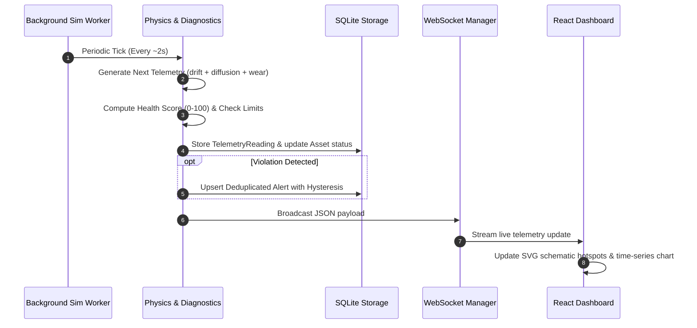

# TwinOps - A Digital Twin Framework for Real-Time Monitoring of Smart Infrastructure

[](https://www.python.org/)
[](https://fastapi.tiangolo.com/)
[](https://react.dev/)
[](https://www.typescriptlang.org/)
[](https://vitejs.dev/)
[](https://tailwindcss.com/)
[](LICENSE)

---

## Abstract

**TwinOps** is an end-to-end, generalized industrial digital twin framework designed for real-time cyber-physical infrastructure monitoring, predictive diagnostics, and condition-based maintenance. Developed as a modular research prototype, TwinOps couples continuous physical telemetry simulation with an explainable health assessment engine, real-time WebSocket streaming, alert lifecycle management with hysteresis protection, and interactive virtual rig visual schematics.

> [!NOTE]
> **Research Notice:** The current iteration operates using synthetic telemetry generated via an Ornstein-Uhlenbeck stochastic mean-reverting process and transparent rule-based health assessment. Telemetry streams represent realistic physics-driven simulated models rather than direct physical hardware measurements. The decoupled architecture provides clear interfaces for future integration of MQTT, OPC-UA, and physical industrial IoT sensors.

---

## 1. Problem Statement

Industrial infrastructure (motors, pumps, compressor fans, turbines) suffers from unplanned downtime and catastrophic mechanical failures when traditional static maintenance schedules fail to detect progressive component degradation. Conventional SCADA systems often provide raw numerical readouts without explainable context or automated wear estimation.

There is a critical need for a generalized cyber-physical digital twin architecture that can:
1. Represent heterogenous industrial machinery under a polymorphic sensor configuration.
2. Ingest continuous telemetry and detect boundary violations with anti-flapping hysteresis.
3. Compute explainable asset health scores and actionable diagnostic recommendations.
4. Allow operators to inject stress and fault conditions in a virtual environment before applying changes to physical production lines.

---

## 2. Research Objectives

- **Generalization:** Establish an asset-agnostic data model capable of monitoring different industrial machinery (electric motors, centrifugal water pumps, axial exhaust fans) without code modifications.
- **Physical Simulation Fidelity:** Implement continuous, inertia-driven physical telemetry generation using mean-reverting stochastic models, progressive wear compounding, and manual fault injection.
- **Explainability:** Deliver a transparent diagnostic health engine that attributes score penalties to specific sensors and generates natural-language maintenance recommendations.
- **Resilient Cyber-Physical Streaming:** Maintain real-time telemetry streaming over WebSockets with automatic fallback to REST polling during network disruptions.

---

## 3. Scope and Limitations

### In Scope
- Generalized asset registry and configurable sensor boundaries (nominal, warning, critical, physical validity limits).
- Background stochastic physics simulator running independently of client browser sessions.
- Explainable health assessment engine with 0–100 scoring, condition classification, and hysteresis.
- Fault injection scenarios (thermal overload, mechanical vibration, overcurrent, hardware sensor failure, accelerated wear).
- Interactive industrial digital twin dashboard featuring live SVG schematics with animated rotational/fluid states and sensor hotspots.
- Maintenance work order scheduling and lifecycle completion tracking.
- Automated testing suite (backend Pytest and frontend Vitest).

### Out of Scope (Current Release)
- Direct physical hardware wiring (GPIO/I2C/SPI).
- Proprietary industrial fieldbus hardware drivers (Modbus RS485, Profibus).
- Certified Remaining Useful Life (RUL) statistical models (e.g. Weibull hazard rates or deep learning LSTM neural networks) — these are designed as drop-in pluggable modules for future research.

---

## 4. System Architecture

```mermaid
graph TD
    subgraph Simulation & Ingestion
        SIM["Physical Sensor Simulator<br/>(Ornstein-Uhlenbeck Process)"]
        FAULT["Fault Scenario Engine<br/>(Thermal / Vibration / Electrical)"]
    end

    subgraph TwinOps Backend Core (FastAPI)
        API["REST API Router<br/>(Assets, Alerts, Maintenance)"]
        WSM["WebSocket Connection Hub"]
        ENG["Simulation Controller"]
        DIAG["Health Assessment Engine"]
        ALERT["Alert Processor & Hysteresis Deduplicator"]
        ORM["SQLAlchemy ORM"]
    end

    subgraph Persistence Layer
        DB[("SQLite Database<br/>twinops.db")]
    end

    subgraph Frontend Client (React + TypeScript)
        STORE["Live Telemetry Stream"]
        DASH["Fleet Overview Dashboard"]
        EXPLORER["Asset Explorer & Provisioning"]
        TWIN["Digital Twin Detail & Virtual Rig"]
        ALERTS["Alerts & Anomaly Center"]
        MAINT["Maintenance Management"]
        SIM_UI["Simulation Control Panel"]
    end

    FAULT --> SIM
    SIM --> ENG
    ENG --> DIAG
    DIAG --> ALERT
    ALERT --> ORM
    DIAG --> ORM
    ORM --> DB

    ENG --> WSM
    WSM -->|WebSocket Broadcast (0.5-2.0s)| STORE
    DB -->|Paginated REST| API
    API --> STORE

    STORE --> DASH
    STORE --> EXPLORER
    STORE --> TWIN
    STORE --> ALERTS
    STORE --> MAINT
    STORE --> SIM_UI
```

---

## 5. Data Flow Diagram



---

## 6. Technology Stack

| Layer | Technologies | Purpose |
|:---|:---|:---|
| **Backend Framework** | Python 3.12+, FastAPI, Uvicorn | High-performance asynchronous REST & WebSocket API |
| **Data Validation** | Pydantic v2, Pydantic-Settings | Strict schema validation, typed DTOs |
| **ORM & Persistence** | SQLAlchemy 2.0, SQLite | Relational modeling, time-series history, transactions |
| **Automated Testing** | Pytest, HTTPX TestClient | Unit and integration test automation (25 backend tests) |
| **Frontend Framework** | React 18, TypeScript 5.4, Vite 5 | Reactive component architecture, typed interfaces |
| **Styling & Theme** | Tailwind CSS 3.4 | Industrial dark UI design system, custom scrollbars |
| **Time-Series Charts** | Recharts | Multi-metric historical plots with threshold reference lines |
| **Iconography** | Lucide React | High-contrast industrial indicators |
| **Client Testing** | Vitest, Testing Library, JSDOM | Component unit and rendering tests (6 frontend tests) |

---

## 7. Project Directory Structure

```
TwinOps/
├── backend/
│   ├── app/
│   │   ├── __init__.py
│   │   ├── main.py              # FastAPI application, lifespan, CORS, WS route
│   │   ├── config.py            # Pydantic BaseSettings configuration
│   │   ├── database.py          # SQLAlchemy engine, session maker, Base
│   │   ├── seed.py              # Initial seed data for Motor, Pump, and Fan
│   │   ├── models/              # SQLAlchemy ORM models
│   │   │   ├── asset.py         # Asset and SensorDefinition models
│   │   │   ├── telemetry.py     # TelemetryReading model
│   │   │   ├── alert.py         # Alert model with lifecycle statuses
│   │   │   └── maintenance.py   # MaintenanceRecord model
│   │   ├── schemas/             # Pydantic v2 request/response schemas
│   │   │   ├── asset.py
│   │   │   ├── sensor.py
│   │   │   ├── telemetry.py
│   │   │   ├── alert.py
│   │   │   ├── maintenance.py
│   │   │   └── simulation.py
│   │   ├── api/                 # REST routing endpoints
│   │   │   ├── assets.py
│   │   │   ├── telemetry.py
│   │   │   ├── alerts.py
│   │   │   ├── maintenance.py
│   │   │   └── simulation.py
│   │   ├── simulator/           # Physics & telemetry generator
│   │   │   ├── generator.py     # Ornstein-Uhlenbeck process & fault modifiers
│   │   │   └── engine.py        # Background task & state manager
│   │   ├── analytics/           # Diagnostic health engine
│   │   │   └── health_engine.py # Rule-based scoring, wear model, hysteresis
│   │   └── services/            # Services
│   │       ├── alert_service.py # Alert upsert & deduplication
│   │       └── websocket_manager.py # Broadcast manager
│   ├── tests/                   # Automated backend test suite
│   │   ├── conftest.py
│   │   ├── test_assets.py
│   │   ├── test_telemetry.py
│   │   ├── test_health_engine.py
│   │   ├── test_alerts.py
│   │   ├── test_simulation.py
│   │   └── test_maintenance.py
│   ├── requirements.txt
│   └── pytest.ini
├── frontend/
│   ├── index.html
│   ├── package.json
│   ├── vite.config.ts
│   ├── vitest.config.ts
│   ├── tailwind.config.js
│   ├── postcss.config.js
│   ├── tsconfig.json
│   └── src/
│       ├── main.tsx
│       ├── App.tsx
│       ├── index.css
│       ├── types/index.ts       # Centralized TypeScript definitions
│       ├── services/
│       │   ├── api.ts           # REST API client
│       │   └── websocket.ts     # WebSocket client with REST polling fallback
│       ├── hooks/
│       │   └── useTelemetryStream.ts
│       ├── components/
│       │   ├── Layout.tsx
│       │   ├── StatCard.tsx
│       │   ├── HealthBadge.tsx
│       │   ├── StatusBadge.tsx
│       │   ├── AssetSchematic.tsx   # Industrial SVG Virtual Rig
│       │   ├── TelemetryChart.tsx   # Recharts time-series chart
│       │   ├── AssetModal.tsx
│       │   ├── MaintenanceModal.tsx
│       │   └── Components.test.tsx  # Frontend unit tests
│       └── pages/
│           ├── OverviewDashboard.tsx
│           ├── AssetExplorer.tsx
│           ├── AssetDetailPage.tsx
│           ├── AlertsCenter.tsx
│           ├── MaintenanceManager.tsx
│           └── SimulationControls.tsx
├── docs/
│   ├── ARCHITECTURE.md          # In-depth architectural design
│   ├── HEALTH_MODEL.md          # Health scoring & mathematical formulas
│   └── API.md                   # Complete REST & WebSocket API docs
├── .env.example
├── .gitignore
└── README.md
```

---

## 8. Installation & Setup Instructions

### Prerequisites
- Python 3.12 or newer.
- Node.js 18+ and npm.
- Git.

### A. Windows (PowerShell)

1. **Clone the repository:**
   ```powershell
   git clone https://github.com/Debarchan-05/Twin-Ops-BT-117-.git
   cd Twin-Ops-BT-117-
   ```

2. **Set up Python Virtual Environment:**
   ```powershell
   python -m venv backend\venv
   .\backend\venv\Scripts\Activate.ps1
   pip install -r backend\requirements.txt
   ```

3. **Install Frontend Dependencies:**
   ```powershell
   cd frontend
   npm install
   cd ..
   ```

4. **Initialize Database & Seed Data:**
   ```powershell
   .\backend\venv\Scripts\python -m backend.app.seed
   ```

5. **Start Backend API Server:**
   ```powershell
   .\backend\venv\Scripts\python -m uvicorn backend.app.main:app --host 127.0.0.1 --port 8000 --reload
   ```

6. **Start Frontend Development Server (In a new terminal):**
   ```powershell
   cd frontend
   npm run dev
   ```
   Open your browser at `http://localhost:5173`.

---

### B. Linux / macOS (Bash)

1. **Clone and setup virtual environment:**
   ```bash
   git clone https://github.com/Debarchan-05/Twin-Ops-BT-117-.git
   cd Twin-Ops-BT-117-
   python3 -m venv backend/venv
   source backend/venv/bin/activate
   pip install -r backend/requirements.txt
   ```

2. **Install Frontend Dependencies:**
   ```bash
   cd frontend
   npm install
   cd ..
   ```

3. **Seed Database:**
   ```bash
   python -m backend.app.seed
   ```

4. **Launch Backend Server:**
   ```bash
   python -m uvicorn backend.app.main:app --host 127.0.0.1 --port 8000 --reload
   ```

5. **Launch Frontend:**
   ```bash
   cd frontend
   npm run dev
   ```

---

## 9. API Reference Summary

Interactive API documentation is accessible at:
- Swagger UI: `http://localhost:8000/docs`
- ReDoc: `http://localhost:8000/redoc`

| Method | Endpoint | Description |
|:---|:---|:---|
| `GET` | `/health` | Service health and simulator status |
| `GET` | `/api/assets` | List registered assets with filtering |
| `POST` | `/api/assets` | Register a new asset with sensor definitions |
| `GET` | `/api/assets/{id}` | Retrieve asset profile and configured sensors |
| `PUT` | `/api/assets/{id}` | Update asset metadata or operational status |
| `DELETE` | `/api/assets/{id}` | Decommission asset |
| `GET` | `/api/assets/{id}/telemetry` | Paginated time-series telemetry records |
| `GET` | `/api/assets/{id}/telemetry/latest` | Fetch most recent telemetry sample |
| `GET` | `/api/telemetry/latest` | Batch fetch latest telemetry across all assets |
| `GET` | `/api/assets/{id}/health` | Detailed explainable health diagnostics |
| `GET` | `/api/alerts` | List alarms with severity and status filters |
| `PATCH` | `/api/alerts/{id}` | Acknowledge or resolve an active alarm |
| `GET` | `/api/maintenance` | List maintenance work orders |
| `POST` | `/api/maintenance` | Schedule new maintenance task |
| `PATCH` | `/api/maintenance/{id}` | Update status or mark completed |
| `GET` | `/api/simulation/status` | Read simulator rate, seed, and active faults |
| `POST` | `/api/simulation/pause` | Pause telemetry background generation |
| `POST` | `/api/simulation/resume` | Resume telemetry background generation |
| `POST` | `/api/simulation/reset` | Reset telemetry and seed |
| `POST` | `/api/simulation/scenarios/{id}` | Inject fault scenario (`overheating`, `excessive_vibration`, etc.) |
| `WS` | `/ws` | Real-time WebSocket streaming |

---

## 10. Health Scoring & Physics Simulation Methodology

### Ornstein-Uhlenbeck Stochastic Process
Telemetry does not jump arbitrarily. Real mechanical and thermal systems possess inertia. TwinOps models sensor telemetry $x_t$ via:

$$x_{t+1} = x_t + \theta (\mu_{\text{effective}} - x_t) \Delta t + \sigma \sqrt{\Delta t} W_t$$

Where:
- $\theta = 0.25$ is the rate of mean reversion.
- $\mu_{\text{effective}} = \text{Nominal} + f(\text{Degradation}, \text{Fault})$ is the drift target.
- $\sigma$ is the sensor volatility scale.
- $W_t \sim \mathcal{N}(0, 1)$ is standard Brownian motion noise.

### Explainable Health Score
- **Healthy Band:** $80.0 \le H(t) \le 100.0$
- **Degraded Band:** $50.0 \le H(t) < 80.0$
- **Critical Band:** $H(t) < 50.0$
- **Critical Sensor Override:** If any single sensor violates its critical threshold, the asset condition immediately collapses to `critical` and health score is capped at $\le 45.0$.
- **Hysteresis:** A 5% threshold delta prevents alarm flapping when telemetry hovers near the boundary.

---

## 11. Example Fault Injection Workflow

1. Navigate to **Simulation Controls** tab in the TwinOps dashboard.
2. Select target asset (e.g. `Main Drive Induction Motor M-101`).
3. Click **Trigger Fault** under **Thermal Overload / Overheating**.
4. Observe the immediate cyber-physical reactions:
   - Stator temperature rises smoothly from $62^\circ\text{C} \to 78^\circ\text{C}$ (Warning) $\to 92^\circ\text{C}$ (Critical).
   - Asset health condition shifts from `healthy` to `degraded` then `critical`.
   - Virtual Rig schematic displays a glowing red thermal hotspot.
   - A critical alarm is created in the **Alerts Center** (with automatic deduplication preventing duplicate alarms).
   - Diagnostic recommendation updates to:
     *"CRITICAL: Urgent thermal overload detected. Shut down unit immediately and inspect bearing cooling & lubricant viscosity."*
5. Return to **Simulation Controls** and select **Clear Faults / Restore Nominal**.
6. The temperature mean-reverts smoothly back to $62^\circ\text{C}$.
7. Open **Alerts Center** and click **Acknowledge** followed by **Resolve** to record corrective actions.

---

## 12. Automated Testing

### Backend Tests (Pytest)
Run the 25 backend unit and integration tests:
```powershell
.\backend\venv\Scripts\python -m pytest backend\tests -v
```

Tests verify:
- Asset creation, validation, and duplicate rejection.
- Invalid sensor telemetry detection.
- Telemetry persistence and pagination.
- Health score boundaries and critical override.
- 5% hysteresis threshold logic.
- Alert deduplication under continuous violations.
- Simulation state transitions (start, pause, resume, reset).
- Deterministic seed reproducibility.
- Maintenance creation and auto-timestamp completion.

### Frontend Tests (Vitest)
Run the frontend component tests:
```powershell
cd frontend
npm test
```

Tests verify:
- HealthBadge rendering across healthy, degraded, and critical conditions.
- StatusBadge operational status rendering.
- StatCard KPI metrics and trends.
- AssetSchematic SVG rendering for motors, pumps, and fans with live metrics.

---

## 13. Screenshots

| Section | Preview |
|:---|:---|
| **Overview Dashboard** | *[Placeholder: Fleet Overview KPI Cards, Health Distribution, Live Anomaly Feed]* |
| **Digital Twin Virtual Rig** | *[Placeholder: Animated SVG Motor/Pump Schematic with Live Telemetry Hotspots]* |
| **Time-Series Charts** | *[Placeholder: Recharts Temperature & Vibration Trends with Threshold Markers]* |
| **Simulation Controls** | *[Placeholder: Fault Injection Panel with Thermal & Vibration Scenarios]* |
| **Alerts Center** | *[Placeholder: Alarm Lifecycle Management with Acknowledge/Resolve Modals]* |

---

## 14. Future Enhancements & Research Roadmap

- **MQTT & OPC-UA Ingestion Gateways:** Incorporate Eclipse Paho MQTT and AsyncUA clients to ingest telemetry from Siemens S7, Allen-Bradley PLCs, and Node-RED edge gateways.
- **Machine Learning Remaining Useful Life (RUL):** Train temporal convolutional networks (TCN) or autoencoder anomaly detectors on historical run-to-failure degradation data.
- **Physics-Informed Neural Networks (PINNs):** Couple physical differential equations for heat conduction and bearing friction with real-time sensor streams.
- **3D Digital Twin Visualizer:** Optional Three.js / WebGL 3D asset models with real-time thermal gradient shader maps.

---

## 15. License

Distributed under the MIT License. See `LICENSE` for more information.
