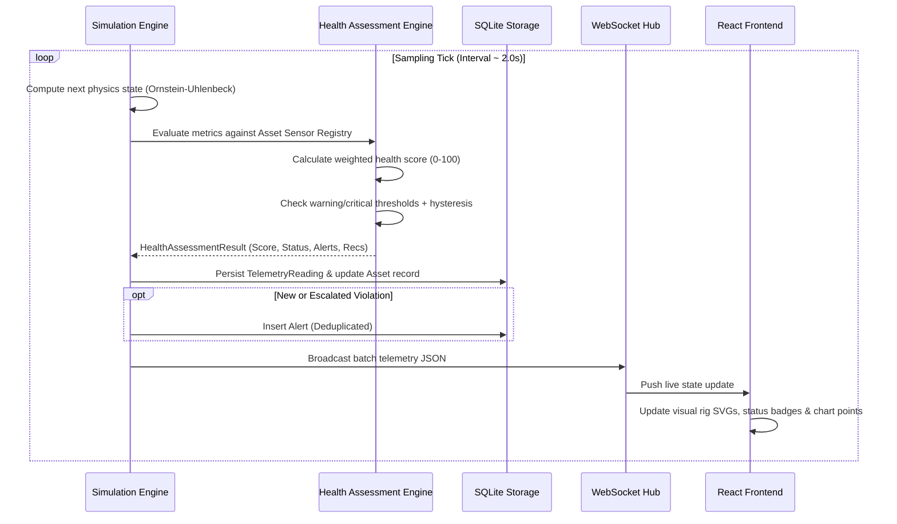

# TwinOps System Architecture & Technical Design

## 1. Executive Architectural Overview

TwinOps is a modular, research-grade Digital Twin Framework designed for real-time industrial infrastructure health monitoring and predictive maintenance.

The architecture decouples the physical telemetry ingestion pipeline from internal asset representations, enabling seamless operation with simulated stochastic sensor data today, while providing clean abstraction layers for physical industrial hardware (e.g., MQTT brokers, OPC-UA servers, Modbus TCP gateways) in future deployments.

```mermaid
graph TD
    subgraph Data Sources & Ingestion
        SIM["Stochastic Sensor Simulator<br/>(Ornstein-Uhlenbeck)"]
        MQTT["[Future] MQTT / OPC-UA Broker"]
    end

    subgraph TwinOps Core Backend (FastAPI)
        ENG["Simulation & Ingestion Engine"]
        REG["Polymorphic Sensor Registry"]
        DIAG["Explainable Health Assessment Engine"]
        ALERT["Alert Lifecycle & Deduplication"]
        ORM["SQLAlchemy ORM & Session Pool"]
        WSM["WebSocket Connection Manager"]
    end

    subgraph Persistence Layer
        DB[("SQLite / PostgreSQL<br/>Time-Series Telemetry & Assets")]
    end

    subgraph User Interface (React + TypeScript)
        WS["WebSocket Stream Listener"]
        FALLBACK["REST Polling Fallback"]
        DASH["Industrial Dashboard Views"]
        SCHEM["Virtual Rig SVGs & Hotspots"]
        CHART["Recharts Time-Series Trends"]
    end

    SIM --> ENG
    MQTT -.-> ENG
    ENG --> REG
    REG --> DIAG
    DIAG --> ALERT
    DIAG --> ORM
    ALERT --> ORM
    ORM --> DB

    ENG --> WSM
    WSM -->|Live JSON Broadcast| WS
    DB -->|Paginated REST| FALLBACK
    WS --> DASH
    FALLBACK --> DASH
    DASH --> SCHEM
    DASH --> CHART
```

---

## 2. Core Architectural Principles

1. **Decoupled Telemetry Ingestion:**
   Telemetry points are received as standardized JSON dictionaries mapped to dynamic sensor keys (`temperature`, `vibration`, `flow_rate`, `pressure`, etc.). The ingestion engine does not assume fixed schemas per asset.
2. **Polymorphic Sensor Registry:**
   Each industrial asset instance defines its own sensor configuration through the `SensorDefinition` entity. This includes:
   - Physical engineering units (`°C`, `mm/s`, `RPM`, `bar`, `m³/h`, `A`).
   - Normal operating baselines (`nominal_value`).
   - Physical sensor validity limits (`min_valid`, `max_valid`).
   - Dual-threshold boundaries (`warning_threshold`, `critical_threshold`, and optional lower bounds).
   - Health weighting coefficient (`weight`).
3. **Explainable Health & Anomaly Diagnostics:**
   Rather than treating asset condition as an opaque black box, TwinOps computes health using transparent rule-based penalty equations, sensor-specific threshold evaluations, and progressive mechanical wear accumulation.
4. **Hysteresis & Alert Flapping Prevention:**
   Industrial alarms implement a configurable 5% hysteresis buffer around warning and critical thresholds. An alarm will not rapidly flicker on and off when noisy telemetry hovers on an exact threshold boundary.
5. **Dual Protocol Communication:**
   Frontend dashboards stream telemetry at 0.5–2.0 Hz over bidirectional WebSockets. If the WebSocket connection drops due to network partitions, the client automatically falls back to periodic REST polling with exponential backoff reconnect attempts.

---

## 3. Data Flow Model



---

## 4. Hardware Extensibility & Integration Roadmap

TwinOps is structured to accommodate physical industrial integration without rewriting existing logic:

```
[ Industrial Equipment ]
         │
         ▼
[ Industrial Protocols: Modbus TCP / Profinet / IO-Link ]
         │
         ▼
[ Edge IoT Gateway (e.g. Raspberry Pi / Siemens IOT2050) ]
         │
         ▼ (MQTT JSON / OPC-UA)
[ TwinOps Bridge Adapter ] ───▶ [ FastAPI Ingestion Endpoint /api/telemetry ]
```

- **MQTT Client Service:** A background MQTT listener can subscribe to topics like `factory/plant1/+/telemetry` and pass incoming payloads directly to `SimulationEngine.process_external_telemetry()`.
- **Machine Learning & Remaining Useful Life (RUL):** The `HealthAssessmentResult` schema is designed to incorporate future Weibull distribution parameters, Long Short-Term Memory (LSTM) degradation models, and autoencoder anomaly scores alongside rule-based indicators.

---

## 5. Security & Isolation Considerations

- All REST endpoints support CORS domain whitelisting.
- Input models are strictly validated through Pydantic v2 schemas.
- Database access uses SQLAlchemy parameterized queries to prevent SQL injection.
- Telemetry timestamps are captured and stored in UTC and converted to local user timezone in the frontend client.
